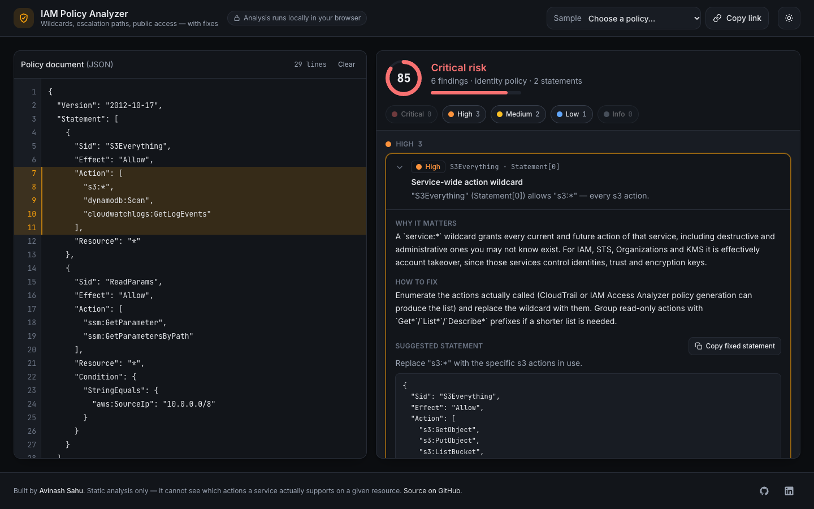

# IAM Policy Analyzer

Paste an AWS IAM policy, get a ranked list of what is wrong with it and a concrete statement to replace it with. Everything runs in the browser — nothing leaves the tab.

**Live demo:** https://avinash9694.github.io/iam-policy-analyzer/



## Why I built this

My day job is a cloud-operations desktop app that scans AWS and Azure estates and audits them for compliance, so I read a lot of IAM policies that "work" and are quietly dangerous: `s3:*` on `*`, `iam:PassRole` sitting next to `lambda:CreateFunction`, bucket policies with `Principal: "*"` and no condition. I wanted a tool that explains those problems the way a reviewer would — what the statement actually grants, why it matters, and what to write instead — without uploading a policy to anyone's server.

## Features

- **Parser with source positions** — a small position-tracking JSON parser gives every statement and element a line range, so a finding highlights the exact lines in the editor and a syntax error points at `line:column` with a specific message (trailing comma, single quotes, comments, unterminated string).
- **Schema validation with hints** — unknown top-level or statement keys (with "did you mean" suggestions), invalid `Effect`, `Action`+`NotAction` conflicts, missing `Resource` on identity policies, malformed `Principal` and `Condition` shapes. Accepts `Version` 2008/2012, `Statement` as object or array, and every element as string or array.
- **13 rules** covering wildcards, privilege-escalation paths (including `iam:PassRole` combinations and `sts:AssumeRole` on `*`), public principals, missing MFA and TLS conditions, data-read actions on `*`, cross-account trust without `ExternalId`, unknown service prefixes and malformed conditions. Wildcards in actions (`iam:*`, `iam:Put*`) are expanded when matching.
- **Deny-aware** — Deny statements are never reported as risky. An unconditional Deny that covers the same actions on the same or a broader resource marks the Allow finding as _mitigated_, and mitigated findings are excluded from the score.
- **Risk score 0–100 with a verdict**, severity filter chips, grouped and expandable findings, each with a "Copy fixed statement" action and links to the relevant AWS documentation.
- **Shareable links** — the policy is compressed into the URL hash (lz-string), so a link reproduces the analysis.
- **Seven sample policies**, dark/light theme following `prefers-color-scheme` with a persisted toggle, keyboard-reachable controls, `aria-live` status, responsive from 360px.

## Rules

| Rule                                   | Severity                                                          | What it catches                                                                                                                                                                                                                                                                                                                      |
| -------------------------------------- | ----------------------------------------------------------------- | ------------------------------------------------------------------------------------------------------------------------------------------------------------------------------------------------------------------------------------------------------------------------------------------------------------------------------------ |
| `admin-wildcard`                       | Critical                                                          | `Allow` with `Action: "*"` on `Resource: "*"` (or `NotResource`)                                                                                                                                                                                                                                                                     |
| `service-wildcard`                     | Critical for `iam`, `sts`, `organizations`, `kms`; High otherwise | `service:*` action wildcards                                                                                                                                                                                                                                                                                                         |
| `privilege-escalation`                 | Critical                                                          | `iam:CreatePolicyVersion`, `SetDefaultPolicyVersion`, `Attach*Policy`, `Put*Policy`, `CreateAccessKey`, `Create/UpdateLoginProfile`, `UpdateAssumeRolePolicy`+`sts:AssumeRole`, `iam:PassRole` with Lambda / EC2 / CloudFormation / Glue / SageMaker, `sts:AssumeRole` on `*` — across statements, through wildcards and `NotAction` |
| `public-principal`                     | Critical                                                          | Resource policy `Principal: "*"` / `{"AWS": "*"}` without `aws:SourceArn`, `aws:SourceAccount`, `aws:PrincipalOrgID`, `aws:SourceVpce` (and similar); `Allow` with `NotPrincipal`                                                                                                                                                    |
| `not-action-allow`                     | High                                                              | `Allow` with `NotAction`                                                                                                                                                                                                                                                                                                             |
| `resource-wildcard-on-mutating-action` | High                                                              | Create / Put / Delete / Update / Terminate… actions on `Resource: "*"`                                                                                                                                                                                                                                                               |
| `data-exfil-actions`                   | High                                                              | `s3:GetObject`, `s3:ListBucket`, `dynamodb:Scan`, `secretsmanager:GetSecretValue`, `ssm:GetParameter(s)`, `kms:Decrypt`… on `Resource: "*"`                                                                                                                                                                                          |
| `cross-account-trust`                  | Medium                                                            | Trust policy admitting another account's root with no `sts:ExternalId`, MFA or `aws:PrincipalOrgID` condition                                                                                                                                                                                                                        |
| `missing-mfa-condition`                | Medium                                                            | Identity-policy grants of IAM, Organizations, key-deletion, bucket/table deletion, logging-disable actions without `aws:MultiFactorAuthPresent`                                                                                                                                                                                      |
| `missing-secure-transport`             | Medium                                                            | S3 bucket policy with no Deny on `aws:SecureTransport = false`                                                                                                                                                                                                                                                                       |
| `condition-sanity`                     | Medium / Low                                                      | Unknown operator (never matches), `Bool`/`Null` with non-boolean values, `StringEquals` on `aws:SourceIp`                                                                                                                                                                                                                            |
| `unknown-action`                       | Low                                                               | Action whose service prefix is not one of ~280 bundled AWS prefixes, or not in `service:Action` form                                                                                                                                                                                                                                 |
| `policy-version`                       | Info                                                              | Missing `Version` or the 2008 grammar                                                                                                                                                                                                                                                                                                |

Scoring: critical 40 · high 20 · medium 10 · low 4 · info 0, summed with diminishing returns (`100 × (1 − e^(−raw/45))`) and a floor per highest active severity (critical ≥ 75, high ≥ 40, medium ≥ 15). Verdicts: 0 clean · <20 low · <45 moderate · <75 high · otherwise critical.

## Architecture

```
src/
├── engine/                 pure TypeScript, no DOM
│   ├── json-ast.ts         position-tracking JSON parser → AST with line/column
│   ├── parse.ts            AST → normalised Policy (arrays everywhere, spans, schema errors)
│   ├── matching.ts         IAM glob matching, ARN-segment coverage, pattern overlap
│   ├── rules/              one module per rule: id, severity, explanation, remediation, docs, check()
│   ├── data/               service prefixes, mutating verbs, escalation paths, condition operators
│   ├── mitigation.ts       Deny statements neutralise matching Allow findings
│   ├── scoring.ts          weights → 0–100 score and verdict
│   └── analyze.ts          parse → rules → mitigation → sort → score
├── components/             editor with gutter + highlight overlay, findings panel, risk score
├── hooks/                  useAnalysis (deferred), usePolicyText (URL hash), useTheme, useCopy
├── lib/                    share (lz-string), clipboard, storage
└── data/samples.ts         the sample policies
```

Text flows one way: the editor owns the string, `usePolicyText` mirrors it into the URL hash, `useAnalysis` runs the engine on a deferred value, and the findings panel reports the selected finding's span back to the editor for highlighting. The engine has no React or browser dependency, which is what makes it cheap to test exhaustively.

## Tech stack

React 18 · TypeScript (strict, `exactOptionalPropertyTypes`, `noUncheckedIndexedAccess`) · Vite 6 · Tailwind CSS v4 · Vitest 3 + Testing Library · ESLint 9 (typescript-eslint strict, react-hooks, jsx-a11y) · Prettier · lz-string · GitHub Actions → GitHub Pages

## Running locally

```bash
npm install
npm run dev        # http://localhost:5173/iam-policy-analyzer/
npm run build      # typecheck + production build into dist/
npm run preview
```

## Testing

```bash
npm test           # vitest run
npm run lint       # eslint, zero warnings
npm run typecheck
```

112 tests: the JSON parser (positions, every error message), the normaliser (shapes, spans, schema errors), glob and ARN matching, every rule with positive and negative cases, Deny mitigation (covering, narrower, conditional, `NotAction`), scoring thresholds, the share hash, and a UI smoke suite (empty state, sample → findings → expand → fix, parse error state, severity filter, theme persistence).

## Project structure

```
.github/workflows/deploy.yml   lint → typecheck → test → build → Pages
docs/screenshot.png
public/favicon.svg
src/__tests__/app.test.tsx
src/engine/__tests__/           parser, matching, mitigation, scoring
src/engine/rules/__tests__/     one suite per rule family
src/test/                       vitest setup and policy-building helpers
```

## Known limitations

- Static analysis only. The tool does not know which actions a service supports resource-level permissions for, so a write action on `*` is reported even where AWS requires `*` (some `ec2:Describe*`-style actions are excluded by verb, but not every exception is).
- Glob subsumption for Deny mitigation is conservative: a Deny is credited only when it clearly covers the Allow (`*`, equality, literal match, or per-ARN-segment prefix wildcards). Conditional Denies never mitigate.
- `unknown-action` checks the service prefix, not the action name — IAM itself does not publish a machine-readable action list in a form small enough to bundle.
- Policy variables (`${aws:username}`) and SCP/permissions-boundary interactions are not modelled.

## Roadmap

- Resource-level-permission awareness per action (bundled from the Service Authorization Reference)
- Diff view: paste two versions of a policy and see which findings appeared or disappeared
- Export findings as JSON / SARIF for CI

## License

[MIT](LICENSE)
